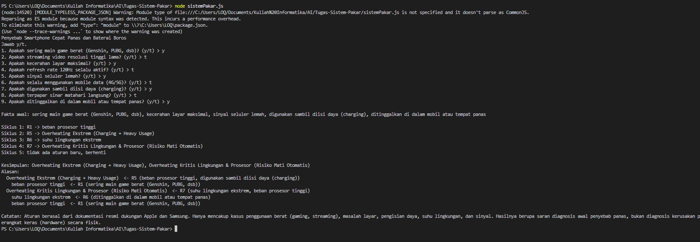
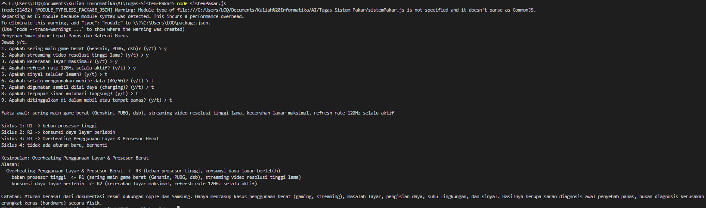
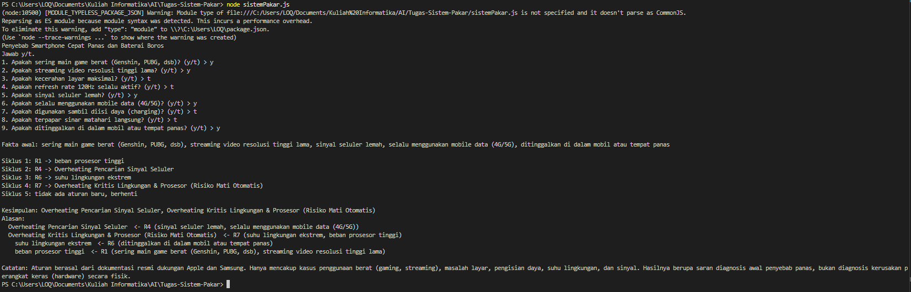

# Tugas 5 Kecerdasan Buatan: Sistem Pakar Sederhana

**1. Nama dan NIM**
- **Nama**: IRLAN HADI
- **NIM**: F1D02410058

**2. Topik dan Cara Menjalankan Program**
- **Topik**: Penyebab Smartphone Cepat Panas dan Baterai Boros (Fokus pada kebiasaan penggunaan Gen Z seperti *gaming* dan *streaming*).
- **Bahasa Pemrograman**: JavaScript (Node.js - ES Module).
- **Versi**: Node.js v24.19.0 (atau yang lebih baru).
- **Cara Menjalankan**: 
  1. Buka terminal (Command Prompt / PowerShell / Git Bash).
  2. Arahkan direktori ke folder *repository* ini.
  3. Jalankan perintah berikut:
     ```bash
     node sistemPakar.js
     ```

**3. Daftar Sumber dan Tabel Aturan**
*Daftar Sumber:*
- **S1**: Samsung Support: *Why does my Galaxy phone get hot?*, https://www.samsung.com/us/support/answer/ANS00076952/, diakses 13 Nov 2026.
- **S2**: Apple Support: *If your iPhone or iPad gets too hot or too cold*, https://support.apple.com/en-us/HT201678, diakses 13 Nov 2026.

*Tabel Aturan:*

| ID | Syarat (IF) | Mode | Kesimpulan (THEN) | Sumber |
|---|---|---|---|---|
| **R1** | sering main game berat (Genshin, PUBG, dsb) **OR** streaming video resolusi tinggi lama | ATAU | beban prosesor tinggi | S1 |
| **R2** | kecerahan layar maksimal **AND** refresh rate 120Hz selalu aktif | DAN | konsumsi daya layar berlebih | S1 |
| **R3** | beban prosesor tinggi **AND** konsumsi daya layar berlebih | DAN | Overheating Penggunaan Layar & Prosesor Berat | S1 |
| **R4** | sinyal seluler lemah **AND** selalu menggunakan mobile data (4G/5G) | DAN | Overheating Pencarian Sinyal Seluler | S2 |
| **R5** | beban prosesor tinggi **AND** digunakan sambil diisi daya (charging) | DAN | Overheating Ekstrem (Charging + Heavy Usage) | S2 |
| **R6** | terpapar sinar matahari langsung **OR** ditinggalkan di dalam mobil atau tempat panas | ATAU | suhu lingkungan ekstrem | S2 |
| **R7** | suhu lingkungan ekstrem **AND** beban prosesor tinggi | DAN | Overheating Kritis Lingkungan & Prosesor (Risiko Mati Otomatis) | S2 |

**4. Metode yang Dipilih**
- **Metode**: *Forward Chaining* (FC).
- **Alasan**: Metode ini dipilih karena sangat cocok untuk sistem yang bersifat *data-driven* (didorong oleh data/fakta). Dalam kasus diagnosis *smartphone*, kita memulai proses dengan mengumpulkan fakta dari kebiasaan pengguna terlebih dahulu. Dari sekumpulan fakta awal tersebut, program akan melangkah maju memicu aturan-aturan yang relevan secara berulang (siklus) hingga tidak ada lagi aturan baru yang terpenuhi, mencapai diagnosis akhir (kesimpulan penyebab).

**5. Tiga Kasus Uji dan Screenshot**

- **Kasus Uji 1**
  - **Fakta awal**: sering main game berat (Genshin, PUBG, dsb), kecerahan layar maksimal, sinyal seluler lemah, digunakan sambil diisi daya (charging), ditinggalkan di dalam mobil atau tempat panas.
  - **Kesimpulan**: Overheating Ekstrem (Charging + Heavy Usage), Overheating Kritis Lingkungan & Prosesor (Risiko Mati Otomatis).
  - **Screenshot**: 
    

- **Kasus Uji 2**
  - **Fakta awal**: sering main game berat (Genshin, PUBG, dsb), streaming video resolusi tinggi lama, kecerahan layar maksimal, refresh rate 120Hz selalu aktif.
  - **Kesimpulan**: Overheating Penggunaan Layar & Prosesor Berat.
  - **Screenshot**: 
    

- **Kasus Uji 3**
  - **Fakta awal**: sering main game berat (Genshin, PUBG, dsb), streaming video resolusi tinggi lama, sinyal seluler lemah, selalu menggunakan mobile data (4G/5G), ditinggalkan di dalam mobil atau tempat panas.
  - **Kesimpulan**: Overheating Pencarian Sinyal Seluler, Overheating Kritis Lingkungan & Prosesor (Risiko Mati Otomatis).
  - **Screenshot**: 
    

**6. Batas Keberlakuan**
Aturan pada sistem pakar ini murni berasal dari dokumentasi resmi dukungan teknis Apple dan Samsung. Sistem ini dibuat khusus untuk memetakan kasus penggunaan berat (*gaming*, *streaming*), masalah layar, pengisian daya, suhu lingkungan, dan sinyal. Hasilnya berupa **saran diagnosis awal penyebab panas**, dan **bukan diagnosis kerusakan perangkat keras (*hardware*) secara fisik**. Batasan ini juga selalu dicetak di layar setiap kali program selesai dieksekusi.

**7. Penggunaan Alat Bantu AI**
Dibantu oleh Gemini AI untuk: merumuskan aturan IF-THEN dari sumber teks naratif dokumentasi pabrikan  serta menstrukturkan pembuatan dokumen `README.md` dan *troubleshooting error module* pada Node.js v24. Kode dan logika telah dievaluasi, dipahami, dan disesuaikan secara mandiri.